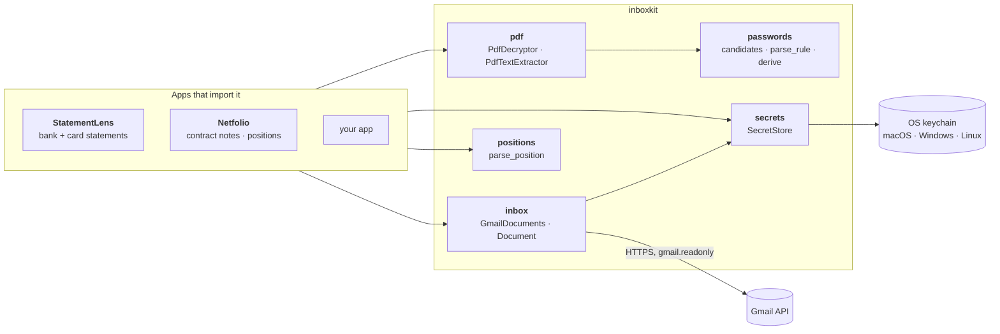
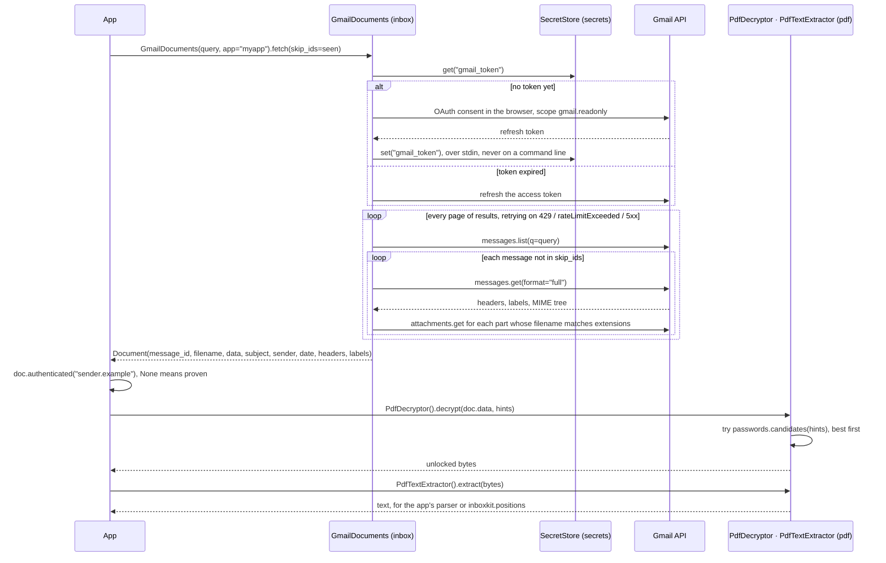
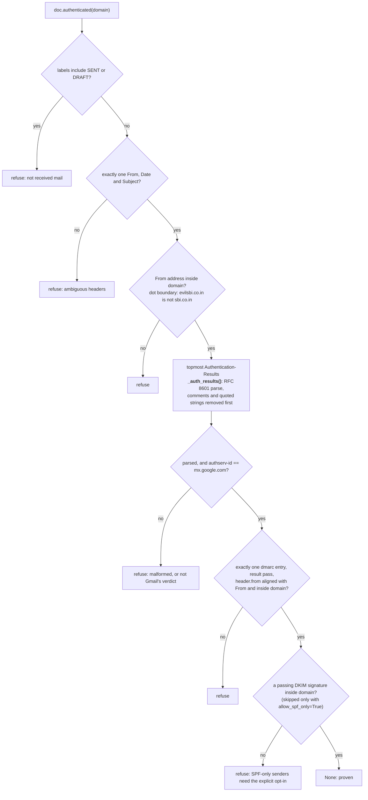

# How inboxkit works

inboxkit is a Python library, not a service. It runs inside the app that imports it, on the user's
own machine. It calls Google's Gmail REST API with Google's own client library and a token that only
that machine holds. No AI, MCP server or third-party service is involved.

## 1. Where it sits

Each app has its own keychain namespace (`SecretStore("<app>")`), and the query is always the app's:
only the app knows which senders matter. Two apps can share one Gmail consent: Netfolio passes
`store=SecretStore("statementlens")` and reuses StatementLens's token, so there is one Google login.

## 2. From a query to parsed text

- `fetch()` pages through every result. If it hits `limit` with more mail left, it sets `truncated`
  instead of silently returning less.
- `skip_ids` makes a daily sync cheap: mail the app has already stored or refused is never downloaded
  again.
- Google's libraries are imported lazily, so `import inboxkit` works without the `[gmail]` extra.

## 3. Proving who sent it: `Document.authenticated(domain)`

Anyone can write any `From:` line, and any `Authentication-Results:` header too. What a sender can't
forge is the verdict the receiving server **prepends**. So only the topmost one counts, and only if
Gmail's own server wrote it.

- It returns `None` when the mail is proven, otherwise the reason. Anything it can't parse fails
  closed.
- `domain` is the organisational domain you trust (`sbi.co.in` covers `alerts.sbi.co.in`).
- DMARC can pass on aligned SPF alone, which a shared sending service makes weaker, so SPF-only
  acceptance is a per-sender opt-in.
- Limit: it assumes the mail arrived by SMTP. Mail injected straight into the mailbox by someone who
  already controls it is out of scope.

## 4. Unlocking: `passwords.candidates(hints)`

Banks and brokers lock PDFs with a password built from facts about you. `candidates()` returns them
best first, and `PdfDecryptor` tries each one in memory:

| Order | Source | Example |
|---|---|---|
| 1 | `custom`: passwords you give explicitly | a password you typed once |
| 2 | `rule_text`: the rule the sender states in its email, parsed by `parse_rule()` and filled in by `derive()` | "last five digits of mobile + DOB in DDMMYY" |
| 3 | `pan`, upper and lower case | contract notes, CAS statements |
| 4 | name × DOB formats, card last 4, mobile | the usual bank conventions |

An unencrypted PDF is returned unchanged. Hints such as the PAN are read from the keychain by the
caller on each run, held in memory, and never written anywhere.

## 5. Modules

| Module | Public API | Worth knowing |
|---|---|---|
| `inboxkit.inbox` | `GmailDocuments(query, *, app, …)`, `.fetch(limit, skip_ids)`, `.authorize()`, `Document` | read-only scope; an empty query is refused (it would read every mail); `headers` keeps every header in order, duplicates included |
| `inboxkit.pdf` | `PdfDecryptor().decrypt(data, hints)`, `PdfTextExtractor().extract(data)` | raises `PdfDecryptError` with the number of candidates tried |
| `inboxkit.passwords` | `candidates(hints)`, `parse_rule(text)`, `derive(components, hints)` | `parse_rule` and `derive` are pure; a new phrasing is a new pattern, never an edit to derivation |
| `inboxkit.secrets` | `SecretStore(service)`, `.get/.set/.delete/.describe()`, `migrate_file_secret()` | macOS `security`, Windows DPAPI, Linux `secret-tool`; a 0600 file only when there is no keychain, and `describe()` says so. On macOS the secret goes over stdin, so `ps` can't see it. |
| `inboxkit.positions` | `parse_position(text)` → a loan, FD or NPS snapshot in paise, or `None` | checks the document's own sums (opening + interest − collections = closing, principal + interest = maturity) and raises `PositionParseError` rather than return a plausible wrong number |

## 6. Rules the code keeps

1. **Read only.** The Gmail scope is `gmail.readonly`; nothing is sent, labelled or deleted.
2. **Fail closed.** An unparseable header, an ambiguous sender or a document whose sums don't hold is
   refused, with the reason, never half-used.
3. **Secrets stay in the keychain.** Tokens and hints never go in a plain file (unless there is no
   keychain, and then it says so) and never go on a command line.
4. **The caller decides what to trust.** inboxkit proves facts (who signed it, what it says); the app
   chooses the query, the domain and the hints.

## 7. Tests

    python3 tests/run.py

Everything runs offline: Gmail is an injected fake service, and locked PDFs are generated on the fly.
The sender check is tested against 17 spoofing attempts, each of which must be refused: a forged
verdict on top, look-alike and public-suffix domains, DMARC passing for someone else, a DKIM signature
only from an outside signer, a comment or a quoted address smuggling a "pass", and malformed headers.
